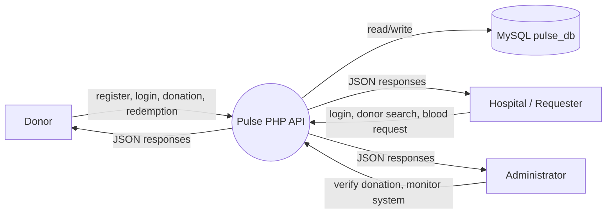
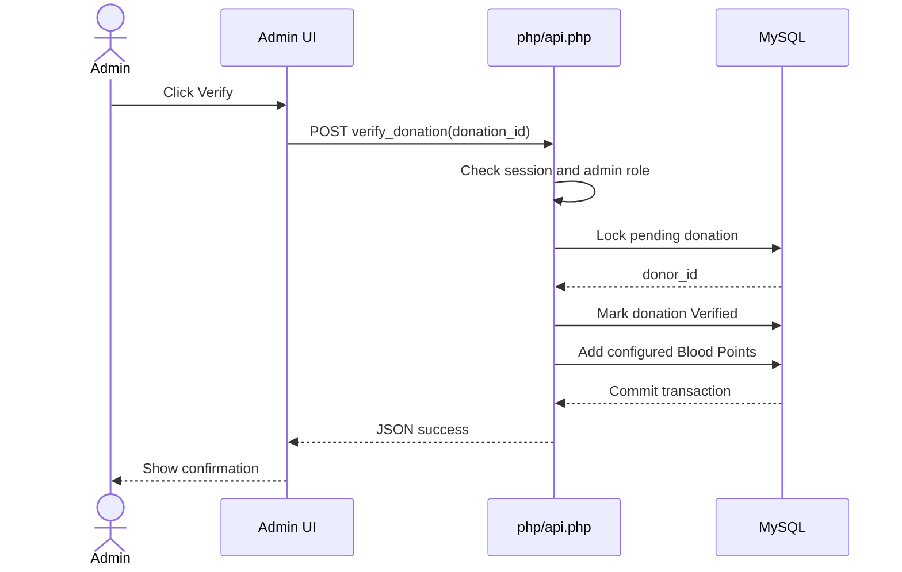

# Pulse Blood Donation System

## 2. Requirement Analysis

### 2.1 Scope and assumptions

Pulse connects donors, hospitals/requesters, and administrators. It supports
registration, login, donor eligibility, blood requests, donation verification,
points, and reward redemption.

Assumptions used for estimates:

- Apache serves the project on port `8080`.
- MySQL serves `pulse_db` on port `3307`.
- Donors wait 56 days after whole-blood donation and 14 days after plasma donation.
- One verified donation awards 50 Blood Points.
- A requester is represented by the `recipient` role in the database.
- The frontend is served from `http://localhost:8080/blood-donation-project/`.
- Frontend application data is fetched from PHP; it is not stored in `localStorage`.

### 2.2 Data Flow Diagram



### 2.3 Data Dictionary

| Entity | Important attributes | Description |
|---|---|---|
| `users` | `user_id`, `name`, `email`, `password_hash`, `role` | Login identity and role |
| `donors` | `donor_id`, `user_id`, `blood_group`, `next_eligible_date`, `blood_points` | Donor profile and readiness |
| `donation_requests` | `request_id`, `recipient_id`, `blood_group`, `component`, `urgency`, `status` | Blood/plasma requirement |
| `donations` | `donation_id`, `donor_id`, `component`, `donation_date`, `status` | Donation awaiting verification |
| `rewards` | `reward_id`, `partner_name`, `points_required`, `coupon_code` | Redeemable reward catalogue |
| `redeemed_coupons` | `redemption_id`, `donor_id`, `reward_id`, `date_redeemed` | Reward redemption history |

| Field | Type / values | Rules |
|---|---|---|
| `role` | `donor`, `recipient`, `admin` | Controls authorization |
| `blood_group` | `A+`, `A-`, `B+`, `B-`, `AB+`, `AB-`, `O+`, `O-` | Required for donors and requests |
| `component` | `Blood`, `Plasma` | Determines eligibility interval |
| `urgency` | `Normal`, `Critical` | Request priority |
| `status` | Request: `Open`/`Fulfilled`; donation: `Pending`/`Verified`/`Rejected` | Workflow state |

### 2.4 Use Cases

| ID | Actor | Use case | Result |
|---|---|---|---|
| UC-01 | Donor / requester | Register | Creates a validated account |
| UC-02 | All users | Log in / log out | Starts or ends a PHP session |
| UC-03 | Donor | View readiness | Shows next eligible date and points |
| UC-04 | Donor | Log donation | Creates a pending donation |
| UC-05 | Hospital | Search donor pool | Returns available eligible donors |
| UC-06 | Hospital | Post requirement | Creates an open blood request |
| UC-07 | Administrator | Verify donation | Marks donation verified and awards points |
| UC-08 | Donor | Redeem reward | Deducts points and records coupon redemption |

### 2.5 Sequence Diagram: Donation Verification



### 2.6 Software Requirements Specification

#### Functional requirements

| ID | Requirement |
|---|---|
| FR-01 | The system shall register donor and requester accounts. |
| FR-02 | The system shall hash passwords and authenticate users with PHP sessions. |
| FR-03 | The system shall reject invalid roles, blood groups, components, dates, and emails. |
| FR-04 | The system shall list only available donors whose eligibility date has passed. |
| FR-05 | The system shall allow requesters to post blood or plasma requirements. |
| FR-06 | The system shall keep donations pending until administrator verification. |
| FR-07 | The system shall award points only after successful verification. |
| FR-08 | The system shall prevent reward redemption when the points balance is insufficient. |
| FR-09 | API responses shall be JSON for frontend requests. |

#### Non-functional requirements

| ID | Requirement |
|---|---|
| NFR-01 | SQL shall use PDO prepared statements. |
| NFR-02 | Unauthorized actions shall return HTTP 401 or 403. |
| NFR-03 | Invalid input shall return HTTP 422 with an error message. |
| NFR-04 | The system shall run on XAMPP Apache and MySQL. |
| NFR-05 | Donation verification and redemption shall be atomic transactions. |

## 3. Project Management

### 3.1 Timeline chart

| Work item | W1 | W2 | W3 | W4 | W5 | W6 |
|---|:---:|:---:|:---:|:---:|:---:|:---:|
| Requirements and diagrams | X | X |  |  |  |  |
| Database schema |  | X | X |  |  |  |
| PHP API and authentication |  |  | X | X |  |  |
| Frontend/API integration |  |  |  | X | X |  |
| Testing and defect fixes |  |  |  |  | X | X |
| Documentation and demonstration |  |  |  |  |  | X |

### 3.2 Function Point calculation

| Function type | Count | Weight | Points |
|---|---:|---:|---:|
| External inputs: registration, login, request, donation, verification, redemption | 6 | 3 | 18 |
| External outputs: donor pool, requests, rewards, profile, admin summary | 5 | 4 | 20 |
| External inquiries: eligibility and session/profile lookup | 2 | 3 | 6 |
| Internal logical files: six database entities | 6 | 7 | 42 |
| External interface files | 0 | 5 | 0 |
| **Unadjusted Function Points** |  |  | **86** |

Using a simple average general system characteristic total of 42:

```text
VAF = 0.65 + (0.01 × 42) = 1.07
Adjusted FP = 86 × 1.07 = 92 FP (rounded)
```

### 3.3 Effort and cost

These are planning estimates, not measured payroll values:

```text
Productivity = 10 hours / FP
Effort = 92 FP × 10 = 920 hours
Cost rate = INR 500 / hour
Estimated cost = 920 × 500 = INR 460,000
```

### 3.4 Risk table

| Risk | Probability | Impact | Mitigation |
|---|---|---|---|
| Incorrect MySQL port/configuration | Medium | High | Keep port in `db_config.php`; verify with a connection test |
| Unauthorized admin operation | Medium | High | Session role checks on every protected action |
| Duplicate or fake donation verification | Medium | High | Pending-state check plus database transaction and row lock |
| Invalid donor date or blood group | Medium | Medium | Server-side enum and date validation |
| Database outage | Low | High | Return explicit HTTP 500 and monitor XAMPP services |
| Reward balance race condition | Low | High | Lock donor/reward row during redemption |
| Personal data exposure | Medium | High | Return only required fields and store password hashes |

## 4. Design Engineering

### 4.1 Architectural design

```text
Browser frontend (HTML/CSS/JavaScript)
                |
        HTTP JSON requests
                |
        Apache + PHP API
     (sessions, validation, roles)
                |
          PDO prepared SQL
                |
             MySQL
```

The backend uses a small single-entry API at
[`php/api.php`](php/api.php). Database connection settings are isolated in
[`php/db_config.php`](php/db_config.php), while date readiness logic is kept in
[`php/eligibility_engine.php`](php/eligibility_engine.php).

### 4.2 Pseudocode: reward redemption

```text
redeem(reward_id, logged_in_user):
    require logged_in_user has donor role
    begin transaction
    find donor and reward while locking the rows
    if reward does not exist or donor.points < reward.required_points:
        rollback
        return validation error
    subtract required_points from donor
    insert redemption record
    commit
    return success and coupon code
```

## 5. Coding

The implemented backend module is [`php/api.php`](php/api.php). It provides
JSON actions for authentication, donor search, leaderboard, requests,
donations, rewards, and administration. The HTML pages call these actions with
`fetch()` and use the PHP session cookie for authentication. A representative
protected operation is:

Runtime database settings and business rules are centralized in
[`php/app_config.php`](php/app_config.php) and can be overridden with
environment variables. The SQL seed records remain optional local demo data,
not application state generated by the frontend.

```php
case 'verify_donation':
    requireRole('admin');
    required($data, 'donation_id');
    $pdo->beginTransaction();
    $stmt = $pdo->prepare(
        "SELECT donor_id FROM donations
         WHERE donation_id = ? AND status = 'Pending' FOR UPDATE"
    );
    $stmt->execute([(int) $data['donation_id']]);
    $donation = $stmt->fetch();
    if (!$donation) {
        $pdo->rollBack();
        respond(['error' => 'Pending donation not found.'], 404);
    }
    $pdo->prepare("UPDATE donations SET status = 'Verified' WHERE donation_id = ?")
        ->execute([(int) $data['donation_id']]);
    $pdo->prepare('UPDATE donors SET blood_points = blood_points + ? WHERE donor_id = ?')
        ->execute([PULSE_DONATION_POINTS, (int) $donation['donor_id']]);
    $pdo->commit();
    respond(['message' => 'Donation verified and points awarded.']);
```

## 6. Testing

### 6.1 Basic path set: `verify_donation`

Control-flow nodes:

```text
N1 Start
N2 Check admin role
N3 Check donation_id
N4 Begin transaction and query pending donation
N5 Donation found?
N6 Rollback and return 404
N7 Update donation status
N8 Award points
N9 Commit and return success
```

Edges:

```text
N1-N2-N3-N4-N5
N5-N6
N5-N7-N8-N9
```

There are three binary decisions in this module: authorization, required
input, and pending-row existence. Therefore:

```text
M = number of decisions + 1 = 3 + 1 = 4
```

The independent basic path set is:

1. **P1:** Start → unauthorized role → HTTP 403.
2. **P2:** Admin → missing `donation_id` → HTTP 422.
3. **P3:** Admin → valid ID → pending row not found → rollback → HTTP 404.
4. **P4:** Admin → valid pending row → update → award points → commit → HTTP 200.

### 6.2 Test cases

| ID | Precondition / input | Expected result |
|---|---|---|
| TC-01 | No session; call `verify_donation` | HTTP 401, `Login required.` |
| TC-02 | Donor session; call `verify_donation` | HTTP 403 |
| TC-03 | Admin session; empty body | HTTP 422, missing `donation_id` |
| TC-04 | Admin session; nonexistent ID | HTTP 404; no points change |
| TC-05 | Admin session; pending donation ID | HTTP 200; status becomes `Verified`; donor gains 50 points |
| TC-06 | Repeat TC-05 with same ID | HTTP 404; points are not awarded twice |
| TC-07 | Register invalid email/date/blood group | HTTP 422; no user is created |
| TC-08 | Redeem with insufficient points | HTTP 422; balance and redemption table remain unchanged |
| TC-09 | Login with seeded admin account | HTTP 200; session contains admin role |
| TC-10 | `donors?blood_group=O+` | Only available, eligible O+ donors are returned |

### 6.3 Validation commands

From the project directory:

```powershell
& 'C:\xampp\php\php.exe' -l php\api.php
& 'C:\xampp\php\php.exe' -l php\db_config.php
& 'C:\xampp\php\php.exe' -l php\eligibility_engine.php
```
